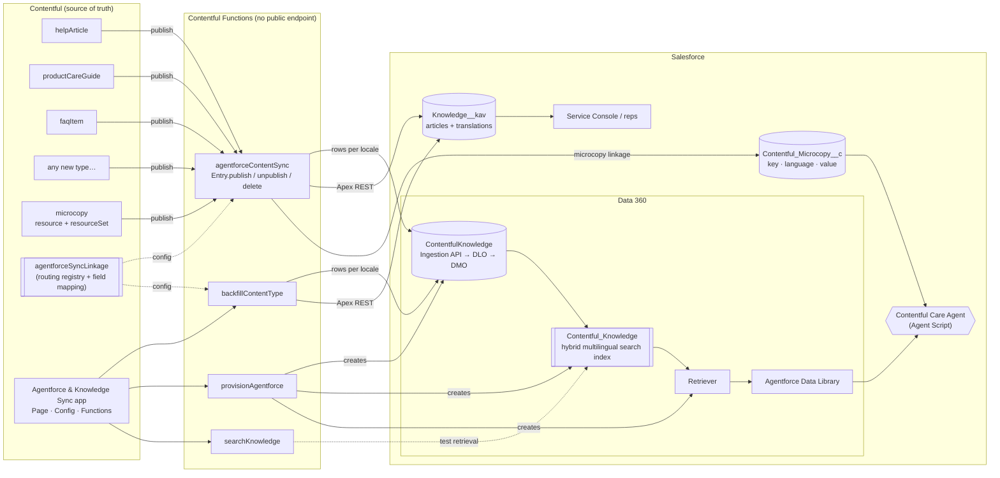
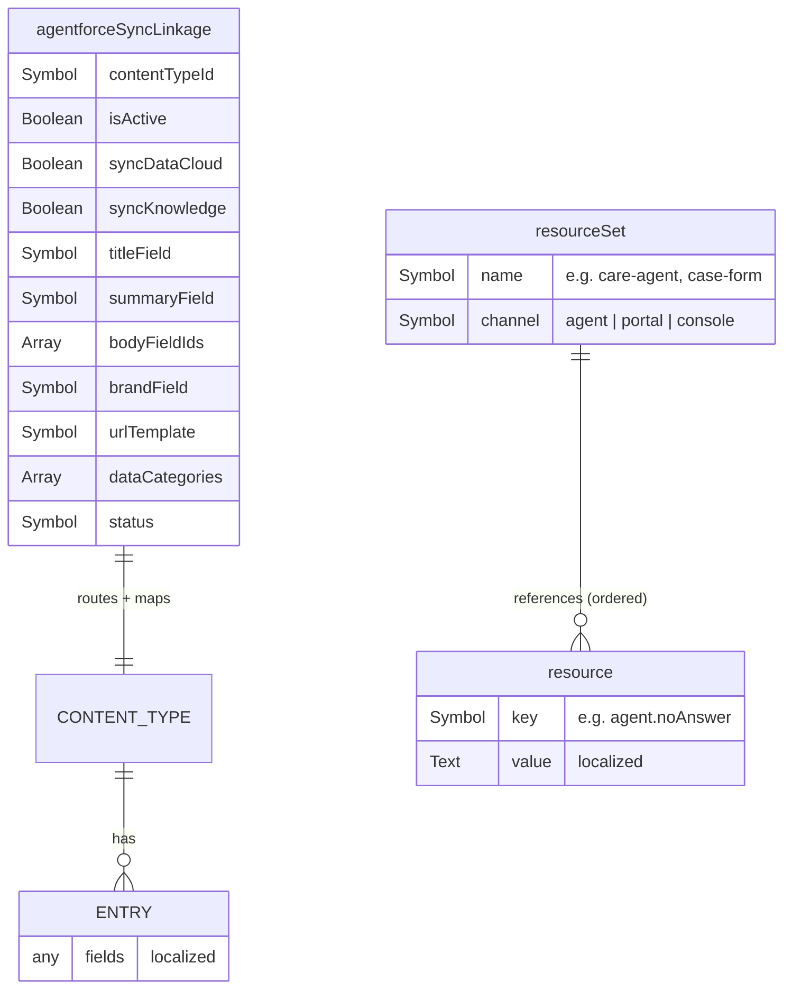
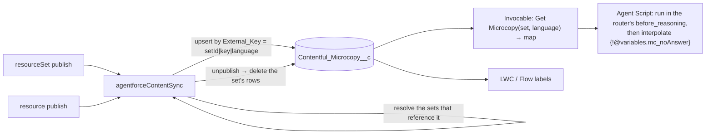

# Conceptual architecture

Contentful is the **system of record for customer-facing service content**. Salesforce consumes
that content in three ways:

- **Agentforce** grounds answers on it through Data 360 retrieval.
- **Service reps** use it as Salesforce Knowledge.
- **Agents and service UIs** speak with editor-managed microcopy instead of hard-coded strings.

Content is authored once and synced automatically, and Salesforce never edits it.

## 1. The big picture



## 2. Principles

| Principle | What it means here |
|---|---|
| **Contentful owns the content** | Publish is the only write path. Edits made in Salesforce are overwritten on the next publish. Every Salesforce record links back to the entry in Contentful (`EditUrl`). |
| **Configuration is data, not code** | A content type is synced because an `agentforceSyncLinkage` entry exists for it. Adding a type is an editor action in the app Page: no deploy, no new schema. |
| **One canonical article shape** | Each linkage maps a type's fields onto *title / summary / body / brand / tags / url*. Every downstream system sees that one shape. |
| **One index, many types** | Customers don't know which content type holds the answer. One retriever ranks across all types and languages. `ContentType__c` and `Brand__c` stay available as filters. |
| **Locale-true** | One row and one Knowledge translation for each locale that is actually translated. A locale that only falls back to another language gets no duplicate row or translation. |
| **Right store for the right shape** | Long-form answers go to the search index and Knowledge. Short UI strings (microcopy) go to a key/value store. Microcopy never enters retrieval. |
| **No inbound surface** | Contentful Functions call Salesforce through client credentials (External Client App). Nothing in Salesforce has to be reachable from the internet. |

## 3. Content model (Contentful side)



- **Knowledge content:**
  - Types: `helpArticle`, `productCareGuide`, `faqItem`, and more later. Each one has its own
    fields that suit editors.
  - The linkage translates those fields to the canonical shape.
- **Microcopy:** this follows Contentful's *dynamic microcopy* pattern.
  - A `resource` is a key with a localized value.
  - A `resourceSet` groups the resources for one view or component, such as the care agent's
    messages or the case-creation form.
  - Editors can change, translate or A/B-test wording without a Salesforce deploy.

## 4. Data flow (Contentful → Salesforce)

```mermaid
sequenceDiagram
  autonumber
  actor Ed as Editor
  participant CF as Contentful
  participant FN as Function: agentforceContentSync
  participant ING as Data 360 Ingestion API
  participant IDX as Search index
  participant KB as Apex: ContentfulKnowledgeSync
  Ed->>CF: Publish entry (en-US, fr-CA, de-DE)
  CF->>FN: App event Entry.publish (full entry, all locales)
  FN->>CF: Look up active linkage for the content type
  FN->>FN: Render one article per translated locale
  par Agentforce grounding
    FN->>ING: Upsert rows {entryId}_{locale}; delete rows for removed locales
    ING-->>IDX: DLO → DMO → incremental chunk + embed (~minutes)
  and Rep knowledge
    FN->>KB: POST upsert (versions, categories)
    KB-->>KB: New major version → translations → publish
  end
  FN->>CF: Write linkage status / lastSyncedAt / lastError
  Note over Ed,KB: Unpublish/delete removes the rows and archives the article
```

## 5. Consumption (Salesforce side)

| Consumer | Reads from | How |
|---|---|---|
| **Contentful Care Agent** (customer-facing) | Retriever, through an Agentforce Data Library | `AnswerQuestionsWithKnowledge` with citations. It is told to answer only from retrieved content and to refuse plus offer a human otherwise. |
| **Any other agent** (Service / Employee) | Same retriever | Add the standard Knowledge action, or use the retriever in a prompt template. |
| **Service reps** | `Knowledge__kav` (record type *Contentful*) | Knowledge sidebar, Service Replies, article search, filterable by `Contentful_Content_Type__c` / brand. |
| **Agent and UI wording** | `Contentful_Microcopy__c` | Agent messages (welcome, no-answer, escalation, safety disclaimers) and LWC/Flow labels, looked up by set + key + language. |
| **Editors (in Contentful)** | `searchKnowledge` | The app Page's **Test retrieval** shows what the agent will find, across types and languages, before customers see it. |

## 6. Microcopy: why it needs its own sync target

Microcopy is short, keyed and per-view, for example `agent.noAnswer = "I don't have that in our
help center yet…"`. Indexing it with the knowledge would hurt in three ways:

- Fragments like "Try again" and "Submit" would rank as passages for real customer questions.
- Retrieval would return text that is about the UI, not about the products.
- Agents and UIs need an exact lookup by key, not semantic search.

So the Contentful → Salesforce sync gets a **second linkage mode** (`target = microcopy`):



- **Storage:** a custom object, not Custom Labels or Custom Metadata. Those need a Metadata API
  deploy for every edit, which would undo the point of editor-managed copy. A custom object is
  plain DML, takes effect immediately, and the agent and LWCs can query it.
- **Languages:** Contentful `fr-CA` maps to `fr_CA`. If a language is missing, the lookup falls
  back to the base language and then to the default, mirroring Contentful's fallback chain.
- **A/B testing:** a set can carry a `variant`. The lookup picks the variant from a session
  attribute, so experiments run in Contentful without changing the agent.
- **Status:** `Contentful_Microcopy__c` is scaffolded in `force-app/`. The microcopy linkage
  mode, the lookup invocable and the agent wiring are the next increment.

## 7. Change cost

| Change | What you do |
|---|---|
| New content type to ground the agent | Add a linkage in the app Page → map fields → *Save & backfill*. No Salesforce change. |
| New language | Add the locale in Contentful. For Knowledge, activate the language in Salesforce. The embedding model is multilingual. |
| Change agent wording | Edit the microcopy resource in Contentful and publish. |
| Different access or chunking for a type | Give it its own linkage object name, which creates a separate index and retriever. Do this for internal-only procedures. |
| New Salesforce org | `sf project deploy`, then the app's **Provision missing** checklist builds the Data 360 pipeline. |
