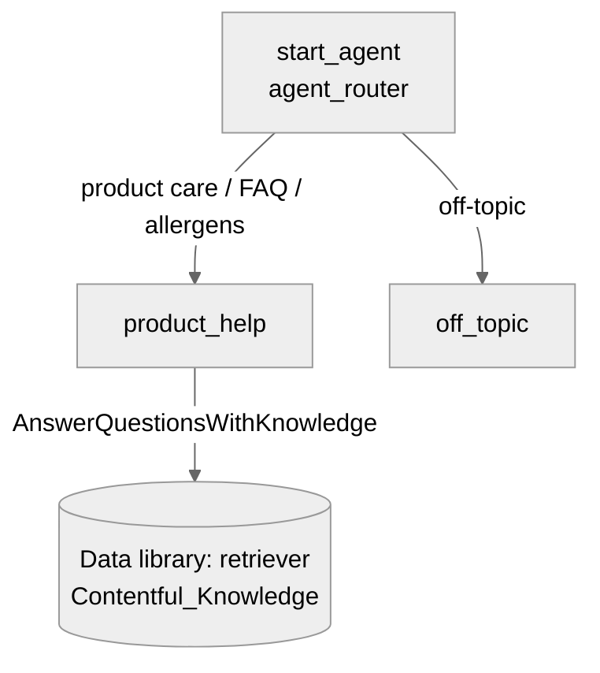

# Agent Spec: Contentful_Care_Agent

## Purpose & Scope

A customer-facing service agent that answers product-care and FAQ questions (machine descaling,
troubleshooting, allergens) only from Contentful-authored help content synced into Data 360. It
answers in the customer's language and cites the source article URL.

Org: `mca-trailsignup`. This is a new, standalone agent. No existing agent in the org is modified.

## Behavioral Intent

- **Grounding:** every answer comes from `AnswerQuestionsWithKnowledge`. Its data library wraps the
  existing custom retriever `Contentful_Knowledge_Retriever_1Cx_CXL71306a3a`, so there is no new
  indexing. That retriever sits on the search index `Contentful_Knowledge`, built over the data
  model object `ContentfulKnowledge__dlm`.
- **Language:** reply in the language the customer writes in. The embedding retrieves across
  languages, so a French question can match an English article and still get a French answer.
- **Citations:** turned on. `Url__c` and `Title__c` come from the source data model object.
- **No answer found:** if retrieval returns nothing, say so and offer to connect the customer to a
  human. Never answer from general knowledge. This matters for allergen and safety questions.
- **Off-topic requests:** politely redirect.
- **No actions with side effects:** the agent creates no cases and changes no records. Handing off
  to a human through Omni-Channel is out of scope for this pass.

## Subagent Posture

| Subagent | Posture | Why | Deterministic controls |
|---|---|---|---|
| agent_router | mixed | default router | transitions only |
| product_help | agentic | open-ended Q&A | must call the knowledge action before answering; refuse if it returns nothing |
| off_topic | agentic | redirect | none |

## Subagent Map

## Actions

### AnswerQuestionsWithKnowledge (product_help)
- **Target:** `standardInvocableAction://streamKnowledgeSearch` (standard action, already exists)
- **Grounding:** `rag_feature_config_id = ARFPC_<libraryId>`. The library is created with
  `sf agent adl create --source-type retriever --retriever-id <1Cx id>`.

## Knowledge Grounding

- **Source type:** RETRIEVER, wrapping the existing active custom retriever. No document upload.
- **Agent user:** a new Einstein Agent User, `contentful_care_agent@...`, with a Data Cloud
  permission set (data space `default`).

## Prerequisites / risks

- The local `sf` CLI (2.123) has no `sf agent adl` command. It needs an upgrade to the latest
  version, 2.159.
- Ownership of an existing Einstein Agent User in this org is unknown, so a dedicated one will be
  created rather than reusing one.
